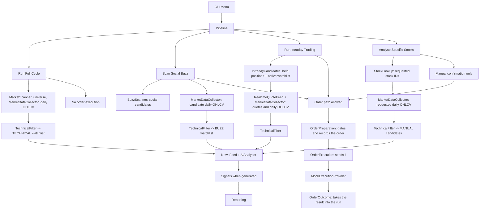

# TW Stock Alpha Agent

Application for Taiwan stock screening, report generation, watchlist management, and mock trade execution.

The current primary interface is the CLI. It scans Taiwan stocks, finds social buzz, runs technical and AI analysis, builds watchlists, and can submit orders through the currently wired mock execution provider.

This project is not financial advice. Treat generated signals as decision support.

## Current Status

- Market: Taiwan stocks.
- Primary UI: CLI at `backend/src/d_presentation/cli/interactive.py`.
- API: FastAPI at `backend/main.py` starts Full Cycle and specific-stock analysis (never order), and Buzz, Intraday and a manual BUY of an analysed stock on the account each run chooses; reads runs, signals, orders, the watchlist and the account; serves market data and valuation; reads and saves the owner's technical strategies; and lets an administrator edit the settings files, which the server runs on at once. See [Web API](#web-api).
- Web UI: `frontend/` (Bun, React, Vite) on the same API through a same-origin `/v1` proxy. See [`docs/web-integration.md`](docs/web-integration.md).
- Order execution: each user's `MockExecutionProvider` by default. `ShioajiExecutionProvider` (Sinopac) takes the runs an administrator starts on it, see [Real broker (Shioaji)](#real-broker-shioaji). It has not been run against a real Shioaji account.
- Database: local SQLite at `stock_agent.db` with `db.backend: sqlite`. `db.backend: postgresql` uses the PostgreSQL credentials in `.env` and refuses to start without them.
- Knowledge store: ChromaDB path is configured by `config/appsetting.yaml`.

## CLI Workflows

Run the CLI from the repository root:

```powershell
just cli
```

Or run it directly:

```powershell
cd backend
uv sync --all-extras
$env:PYTHONPATH = "src"
uv run python -m d_presentation.cli.interactive
```

The CLI signs in first, with a username or an email and the password, and only an administrator may use it: it is the
only way to a manual BUY and to a real broker. On an installation with no user yet it sets up the first administrator
instead (username, email, password), who takes over the data the single-user versions kept: the runs, the watchlist,
the mock account and the saved strategies. Before each menu option it reads the user again, so an administrator who
was deactivated or demoted loses the CLI at the next option. A locked-out administrator gets a new password on the
machine with `just reset-password <username or email>`.

Menu behavior:

| Option | Workflow | What it does | Orders |
| --- | --- | --- | --- |
| 1 | Run Full Cycle | Scans the full market, builds a `TECHNICAL` watchlist, runs news and AI analysis, generates next-session signals. | Never submits orders. |
| 2 | Scan Social Buzz | Finds discussed stocks, enriches market data, keeps technical survivors as `BUZZ`, analyses them, generates signals. | Submits only if market and order checks allow. |
| 3 | Run Intraday Trading | Loads held positions and active watchlist, refreshes market data, revalidates technicals and AI, generates signals. | Submits only if market and order checks allow. |
| 4 | Analyse Specific Stocks | Loads the requested stock IDs and runs the technical filter, news and AI on every one of them, a technical failure included, then offers them all for the `MANUAL` watchlist. | No automatic order. Manual BUY override requires confirmation. |
| 5 | Value Specific Stocks | Shows TTM EPS from MOPS filings, the exchange's official close and the current P/E, asks a target P/E, then prints three fair-price scenarios and an AI explanation built from those numbers. | Never. No watchlist write either. |
| 6 | Scan Undervalued Stocks | Screens every listed and OTC stock at a target P/E and minimum undervaluation, optionally confirms the matches with the active technical strategy, and can ask the AI to explain the top matches. | Never. No watchlist write either. |
| 7 | Account History | Shows cash, positions with unrealized PnL at the latest quote, the equity curve since the first fill, and the account as of a date you enter. Warns about each position with no live quote, which is then priced at its last daily close, or at its average cost when no price came back. | Never submits orders. |
| 8 | Load Built-in Strategy | Lists the built-in technical strategies and Cancel. The chosen one replaces the saved strategy for menus 1, 2, 3, 4 and 6 until the CLI exits; the menu header names it. Saved settings and the Web API are unchanged. | Never. |

Every BUY or SELL decision ends as one row in the `orders` table with its run id and decision id: REJECTED with the reason when a gate refuses it (market closed, a quote older than `freshness.realtime_max_lag_minutes`, a broker the run may not reach, a SinoPac limit). IOC orders trade only in continuous trading, 09:00 to 13:25 on weekdays; the opening call auction (08:30-09:00) and the closing call auction (13:25-13:30) take ROD only, so an order then is REJECTED as `MARKET_CLOSED`, otherwise what the broker did with it, including the fee, the tax and, for a SELL, the realized PnL. Orders are LIMIT at the decision's price and IOC. The limit is a valid exchange tick (`LimitPriceRule`, with the TWSE/TPEx tick table in `market.stock_ticks` and `market.etf_ticks`): a quote off the tick grid rounds up for a BUY and down for a SELL, and sizing prices a BUY at that limit. One run decides best composite score first, a tie going to the lower stock id. Each BUY risks `analysis.risk_per_trade_pct` of the account's equity: its cash plus every held position at the latest price the run has for it (the realtime quote, else the last daily close, else the average cost, as menu 7 marks it), fixed once before the run's first decision. The quantity is capped by the cash the run's earlier BUYs left, their fees included, so a run never commits more than the account's cash; when it runs out, the lower-scored stocks get HOLD. A manual BUY is sized the same way. Fees and tax come from `market` in `config/appsetting.yaml`: a SELL pays the transaction tax `tax_rate` (0.3%) on a stock and `etf_tax_rate` (0.1%) on an ETF, which is a code starting with `00`. A bond ETF, a `00` code ending in `B` such as `00679B`, pays no tax on a SELL traded on or before `bond_etf_tax_exempt_until` (2026-12-31), and `etf_tax_rate` after it.

### Specific Stock Flow

When you enter a stock such as `2330`, the app should only research that stock:

1. Load the stock from the stock provider.
2. Fetch OHLCV data and calculate indicators.
3. Run the technical filter.
4. Run news and AI analysis on the stock even when the technical filter failed it, so you see the whole report.
5. Show the stock report.
6. Offer the stock for the `MANUAL` watchlist.

Adding the stock to the watchlist is a separate manual confirmation. A manual BUY override is also separate. It is sized with fees included and still goes through the same order steps, which check the broker the run chose, market-open status and the age of the quote. The web app's manual BUY takes the shares the user asks for instead of the sizing. The CLI prints the order's status and reason, or why no order could be built.

## What Counts As "Good"

The project currently treats a stock as worth acting on only after multiple gates:

1. Technical filter has no hard failure.
2. News and AI analysis produce an acceptable report.
3. Combined score passes configured thresholds.
4. Account risk checks do not block the stock.
5. Order execution is allowed by the market clock.
6. Quantity and mock account constraints are valid.

Main thresholds live in `config/appsetting.yaml`:

```yaml
analysis:
  technical_weight: 0.5
  ai_weight: 0.5
  min_combined_score_buy: 80
  max_combined_score_sell: 30
```

### Technical strategies

A technical strategy is a list of rules, each a formula the user builds from parts, plus the score each rule's result adds or takes away. A name is only a label: the formula alone decides.

- Data: a field of a completed daily bar (`open`, `high`, `low`, `close`, `volume` in shares), `bars_ago` trading days back, or the latest price (the realtime quote, else the last close).
- Indicators: SMA of closes or volumes, RSI, MACD, Bollinger, Stochastic, ADX, ATR, OBV and MFI. Each has a stable id such as `ind_a` and parameters the user sets, such as `{"kind": "sma", "period": 37}`. Changing a period changes every rule that reads that id.
- Arithmetic (`add`, `subtract`, `multiply`, `divide`), comparisons (`gt`, `gte`, `lt`, `lte`, `eq`, `ne`, `crosses_above`, `crosses_below`) and `all`/`any` groups, nested as deep as needed.
- Effects: `block_on_fail` rejects the stock, `reduce_score_on_fail` and `increase_score_on_pass` move its score. Each rule's effect applies once.

A stock with fewer daily bars than its strategy needs, or whose formulas divide by zero or read a value its history cannot give, fails the technical step with score 0. No rule result stands in for missing data.

The developer ships one strategy, `config/strategies/balanced.json`, listed under `technical.built_in_strategies` in `config/appsetting.yaml`. It scores every stock as the criteria class it replaced did (`backend/tests/test_built_in_strategies_regression.py`). An owner's first read of the settings saves an independent copy of every built-in strategy, with `technical.initial_strategy_id` (`balanced`) selected for every workflow. The `conservative` and `aggressive` strategies no longer ship: an owner who first read while they did keeps the saved copies as their own strategies, and the one in use stays in use. Later saves go to the database through `PUT /v1/technical-settings` and never change the files. Menu 8 of the CLI loads a built-in strategy for the runs of that CLI session only.

## Watchlist Types

`WatchlistType` is the source of truth for why a stock is on the watchlist:

| Type | Meaning |
| --- | --- |
| `TECHNICAL` | Passed the full-market technical scan. Stays active through the close of the `watchlist.automatic_expiry_sessions`-th (1) trading session that opens after Full Cycle last selected it, so Friday evening's entries last through Monday's session. |
| `BUZZ` | Came from social buzz and passed technical filtering. Expires like `TECHNICAL`, counted from the last Buzz scan that selected it. |
| `MANUAL` | User reviewed a specific-stock report and manually added it. Never expires. |

A stock has one `watchlists` row per type, so it can be `TECHNICAL`, `BUZZ` and `MANUAL` at once. `WatchlistRule` renews an automatic row each time its workflow selects the stock again and never changes a `MANUAL` row. Adding a stock that is already on the manual watchlist prints `Already present on manual watchlist`.

## Application Flow



Important distinction:

- `NewsFeed` and `AiAnalyser` only gather news, ask the AI and combine the technical and AI scores into the composite score.
- `Pipeline` (`backend/src/b_application/pipeline.py`) holds every workflow as one method. Each method lists the use cases it runs, so it alone decides whether signals, reporting, watchlist writes or order steps happen.
- The order steps run one decision at a time: `OrderPreparation` checks the trading phase, the quote's age and the broker the order would reach, and records the order, `OrderExecution` sends it to the broker, and `OrderOutcome` records what the broker did.
- `MarketScanner` loads the universe, `StockLookup` the requested stock IDs and `IntradayCandidates` the held and watched stocks. `MarketDataCollector` loads daily OHLCV, `RealtimeQuoteFeed` loads the realtime quotes that price orders, and `TechnicalFilter` calculates the strategy's indicators and applies its rules.

## Architecture

The code follows the existing Clean Architecture split:

| Layer | Path | Responsibility |
| --- | --- | --- |
| Domain | `backend/src/a_domain` | Models, ports, enums, pure rules. No application, infrastructure, or presentation imports. |
| Application | `backend/src/b_application` | Use cases, the one `Pipeline` with every workflow, the pipeline status, and the settings classes in `b_application/config/`. |
| Infrastructure | `backend/src/c_infrastructure` | Database, market data, AI adapters, feed providers, LINE platform, mock trading. |
| Presentation | `backend/src/d_presentation` | CLI, Web API, the one composition root both use (`dependencies.py`). |

Application use cases coordinate work. Domain rules own business decisions. Infrastructure implements ports.

## Configuration

Main files:

| File | Purpose |
| --- | --- |
| `config/appsetting.yaml` | Active AI model (`ai.active_model`, Claude Haiku by default) and the ones a user may pick instead (`ai.user_selectable`), logging, analysis weights, thresholds, folders, mock account, the technical settings owner and built-in strategy list, and under `sources` every outside endpoint (TWSE, TPEX, MOPS, PTT, news, AI, LINE) with the text formats their pages use (the OpenAPI's Chinese field names included), the open data's attribution, their timeouts and how much of each page is read. The settings classes are in `backend/src/b_application/config/`. |
| `config/strategies/*.json` | The built-in technical strategies, one file each. An owner's own strategies and selections are saved in the database. |
| `config/instructions.yaml` | AI report prompts and RAG injection prompts. |
| `.env` | API keys, optional database credentials and the Shioaji credentials. |

### Personal or public deployment

One codebase runs as two deployments. `audience` in `config/appsetting.yaml` chooses, `personal` by default, and one
table decides what each may use (`Audience` in `backend/src/a_domain/types/enums.py`):

| `audience` | Daily history and index trend | Realtime quotes | Buzz, Intraday, manual BUY | Articles for the AI step | Valuation (menus 5, 6) | Brokers |
| --- | --- | --- | --- | --- | --- | --- |
| `personal` (the owner's machine) | the exchanges' own daily reports of each date (TWSE's MI_INDEX, TPEX's closing quotes, each index per month), kept in `ohlcv_data`, with or without a Shioaji login | Shioaji snapshots, on the environment's key pair | Yes; without the key pair the Web answers 403 `realtime_quotes_unavailable` to Buzz and Intraday | cnyes and Yahoo news, and Tavily web search | MOPS EPS | those the environment allows |
| `public` (a free public website) | the open-data archive only | none | Refused: the Web answers 403 `realtime_quotes_unavailable`, the CLI refuses menus 2 and 3 and offers no manual BUY | the archived material information and the TWSE news naming the stock, of the last `analysis.material_information_days` (30), only | Refused: the Web answers 403 `mops_unavailable`, the CLI refuses menus 5 and 6 | `mock` only; startup refuses any other |

A public deployment never builds the Shioaji, cnyes, Yahoo news, PTT, MOPS or Tavily adapter: Shioaji's market data
comes with the owner's own broker login, Yahoo's terms forbid automated collection, cnyes forbids reproduction without
consent, MOPS's robots.txt disallows every path and TWSE's terms forbid the automated download of its site's reports,
and PTT is read only by Buzz. Its AI step reads a stock's
archived material information and the TWSE news naming it; a stock with none of them and no archived financials is not
sent to the AI, its run log says so, and its decision rests on its technical score alone. On every audience the AI
prompt also carries the stock's archived financials: its latest two archived quarters and its latest month's revenue. Its strategies need 61 sessions of closes, so until the archive holds them every run
says how many it holds and finds no candidate. LINE is not part of the table and works as on a personal deployment.

A personal deployment reads its daily history from the exchanges' own reports of each date on their sites, with no
login (`sources.exchange.daily_reports`). TWSE's MI_INDEX and TPEX's closing quotes each answer every security of one
session in one request, with each stock's official change from the session's reference price; the rows kept are the
stocks with a four-digit code, the listings' own universe. Each exchange's own index (the TAIEX, the TPEx Index) comes
per month from two reports: its open, high, low and close (MI_5MINS_HIST, TPEX's index report) and its market's volume
with the index's official change (FMTQIK, TPEX's trading index). TWSE refuses an address for minutes after more than
about 3 requests in 5 seconds, so each site is asked at most once every `market_data.history_request_interval_seconds`
(3), from every runtime together; a backfill takes about 3 seconds a session. Shioaji serves only the realtime quotes
and the broker. The bars are kept in `ohlcv_data` as reported, never in the open-data archive. The Web API's timer
brings them to the last settled session over the stock page's one-year chart (`market_data.history_backfill_bars`, 251
sessions) at its start and then every `api.archive_interval_hours`, asking only for the sessions it lacks; a run fetches
the sessions of its own window it lacks, older ones included. A session the cache holds without any change, as
Shioaji's daily quotes saved them before, is asked again once and takes the reports' changes. A read adjusts the bars
before every corporate action whose reference the exchange gives in the change, such as a split (`HistoryAdjustmentRule`).
On an ex-dividend or ex-rights day TWSE writes `X` and a change of 0.00 and TPEX writes `除息` or `除權息` with no number:
neither compares the close to a reference, so the bar keeps no change and that day stays as listed. Without the
environment's Shioaji key pair there is no realtime quote. The SDK's Sentry reporting (`LOG_SENTRY`) and its
`shioaji.log` (`SJ_LOG_PATH`) are off unless the environment sets them. Schema version 5 (`just db-migrate`) drops the
Yahoo bars the cache held before.

The audience, like the environment, changes only when the app restarts: a reload or a Web save that changes it is
refused, and the settings form shows it read-only. `GET /v1/market/audience` answers the audience and the table's
capabilities, and the web app hides what the site cannot do: Buzz and Intraday on the runs page and the valuation
page, whose address then says why it is not offered. `GET /v1/market/attribution` answers the credit the Open Government
Data License v1 requires of every page that shows the open data: each provider, the datasets the site reads from it,
the license's notice, and its name and address (`sources.attribution`).

### Real broker (Shioaji)

Every run that may order chooses its account when it starts: Buzz, Intraday and a manual BUY order on the user's mock
account by default, or, for an administrator on a personal site whose Shioaji login is up, on SinoPac. The choice holds
for the whole run (`workflow_runs.execution_provider`), and a follow orders on the mock account only. The Web asks it in
each start's confirmation (`?broker=shioaji`), and the CLI asks `Order on` before menus 2 and 3 and before each manual
BUY of menu 4, only where SinoPac is offered. The environment decides which SinoPac server, with which credentials,
from one table (`SystemEnvironment` in `backend/src/a_domain/types/enums.py`):

| `environment` | SinoPac server and credentials | Database |
| --- | --- | --- |
| `dev` (a developer's machine) | simulation, no real money, with `SHIOAJI_API_KEY_TEST` and `SHIOAJI_SECRET_KEY_TEST` only | SQLite or PostgreSQL |
| `test` (staging before launch) | simulation, no real money, with `SHIOAJI_API_KEY_TEST` and `SHIOAJI_SECRET_KEY_TEST` only | SQLite or PostgreSQL |
| `prod` (the live service) | production, real money, with `SHIOAJI_API_KEY`, `SHIOAJI_SECRET_KEY`, `SHIOAJI_CA_PATH`, `SHIOAJI_CA_PASSWORD` and `SHIOAJI_PERSON_ID` only | PostgreSQL only |

A personal site reads its realtime quotes from Shioaji's snapshots, each stamped with the exchange's time of the stock's
last trade, over one login per process that the SinoPac broker shares. Dev and test log in to the simulation server,
which serves the same exchange data; prod logs in to production. Without the key pair, or when that login fails, the
site starts with no realtime quote and no SinoPac: every quote is refused and nothing is ordered. In prod, SinoPac is
offered only once its account check passes, the CA certificate included; a failed check is logged and leaves the mock
account. Shioaji allows 50 market-data queries per 10 seconds and 500 stocks per snapshots request, which
`market_data.quote_*` keeps to.

Each SinoPac order passes the order gates right before it is sent (`BrokerAccessRule` and `BuyLimitRule` in
`backend/src/a_domain/rules/trading/order_rule.py`), or is recorded REJECTED with the reason: the run chose SinoPac, the
user is still an active administrator, the site's audience offers it, its login is up, and on the server the environment
trades on. Each SinoPac BUY costs at most `trading.max_order_value` (NT$100,000) at its limit price, and the day's SinoPac
BUYs at most `trading.max_daily_buy_value` (NT$300,000), counted from the trading journal, which holds every order before
it is sent. A SELL is never held to them and sells only shares the account holds. The account page shows the SinoPac
account next to the mock account (`GET /v1/account/history?broker=shioaji`).

`dev` and `test` refuse to start while any of the five production variables is set in the environment or `.env`, so the
production key lives only on the production machine; the refusal names the variables, never their values. Nothing
else chooses simulation: a test machine cannot log in with the production key, and prod cannot run in simulation.

On the production machine, keep the SinoPac CA certificate at `secrets/Sinopac.pfx` in the checkout (the `secrets/`
folder is gitignored) and set `SHIOAJI_CA_PATH` to that file's path. Before a run on SinoPac the CLI shows a panel with
the server, simulation or PRODUCTION, and the limits.

How the adapter trades: quantities are shares; whole 1000-share lots go as one board-lot order, LIMIT IOC, and the rest as one intraday odd-lot order, LIMIT ROD, because TWSE and TPEx take intraday odd lots as ROD only. Before sending, it refuses a BUY that the cash cannot pay, because the broker checks the trading limit, not the cash. Cash is the bank balance minus settlement payments due and minus the BUYs the broker lists as dealt today. A part still working after `shioaji.max_polls` status reads `shioaji.poll_interval_seconds` apart (about five seconds) is cancelled, the odd-lot ROD part included, so no order is left working. The order then ends with what filled and its fee, and its reason lists each part with its time in force, its status and the shares it dealt. A part the broker still reports as working after the cancel, or a timed-out call it cannot find again, ends the order FAILED with a reason that says to check the broker.

Environment variables are loaded from `.env` or `../.env` relative to the backend process. Common keys:

```env
OPENAI_API_KEY=
GROK_API_KEY=
GEMINI_API_KEY=
GROQ_API_KEY=
NVIDIA_API_KEY=
ANTHROPIC_API_KEY=
TAVILY_API_KEY=
LINE_CHANNEL_ID=
LINE_CHANNEL_SECRET=
LINE_CHANNEL_ACCESS_TOKEN=
SHIOAJI_API_KEY_TEST=
SHIOAJI_SECRET_KEY_TEST=
DB_USER=
DB_PASSWORD=
DB_HOST=
DB_PORT=
DB_NAME=
```

The accounts key encrypts the saved usernames and emails and keys their lookup. The app makes it itself: the first
start of the CLI or the Web API creates `secrets/accounts.key` (32 random bytes, mode 600, gitignored) and logs its
path, never the key. Back up `secrets/` with the database. The CLI and the Web API refuse a key other than the one the
users were saved with. Losing it locks every account: a new key does not help, so restore the original
`secrets/accounts.key` from the backup. The `ACCOUNTS_KEY` variable, from the environment or `.env`, overrides the
file, for Docker or production; a blank value counts as unset. `environment: prod` requires the variable and never
creates the file, because a production app folder, such as a Docker container's, may not survive a redeploy, and a key
created there would lock every account at the next deploy.

`db.backend` in `config/appsetting.yaml` chooses the database, never the `DB_*` keys. `postgresql` needs `DB_USER`, `DB_PASSWORD`, `DB_HOST` and `DB_NAME`. `sqlite` keeps the local `stock_agent.db`, and refuses to start while all four are set.

## Development Commands

From `backend`:

```powershell
uv sync --all-extras
$env:PYTHONPATH = "src"
uv run ruff check .
uv run ruff format --check .
uv run pytest -q
uv run python tools/architecture_check.py src --pyright
```

`tools/architecture_check.py` checks the rules of `docs/clean_architecture_guide.md` (layer direction, one `apply` per domain rule, one `execute` per use case, `@override` on every adapter method, function length and complexity, no hard-coded URLs) and, with `--pyright`, counts pyright errors. It prints a count per rule and must end at `TOTAL 0`.

Run the API and the web UI, in this order, from the repository root:

```bash
just run-bn   # backend Web API on http://127.0.0.1:8800, one worker; the first start creates secrets/accounts.key
just run-fn   # frontend dev server on http://127.0.0.1:5173, proxying /v1 to the backend
```

Users sign in to the web app with a username or an email and a password. On the first start with no user, the
backend prints a one-time setup code on its console: the first-time setup in the web app needs it, so the first
visitor of a server reachable from elsewhere cannot make themselves its administrator (the CLI needs none). After
that, anyone may register as a user while `accounts.registration_open` is on. `HOST` and `PORT` move the backend;
serve another network only behind a TLS reverse proxy (see `docs/web-integration.md`).

Run Docker:

```powershell
docker compose up --build
```

### Database migrations

The database commands open only the database that `db.backend` selects, so they need no accounts key, AI key or broker. Run them from the repository root with the app stopped:

```bash
just db-status                        # where the database is, its schema version and the code's, pending steps, rows per table
just db-backup                        # a copy in backups/, named after the UTC time and the schema version
just db-migrate                       # a backup, then the pending upgrade steps in one transaction; nothing pending changes nothing
just db-restore backups/<file> --yes  # a backup of the current database, then the given backup put back
```

On PostgreSQL the backups use `pg_dump` and `pg_restore`, which must be on `PATH`. [docs/database-migrations.md](docs/database-migrations.md) covers the commands, backups and restore, and how to write and test an upgrade step.

## Web API

The API runs on the same runtime as the CLI: `backend/src/d_presentation/dependencies.py` builds it once at startup, with the same trading-setup checks, so the API refuses to start on any setup the CLI refuses. The OpenAPI page is at `/docs`; `frontend/src/shared/api/openapi.json` is the committed contract the web UI generates its types from.

Access: public (sign-in, registration, the first-time setup, the built-in strategies, `/v1/market`), signed in (the session cookie `POST /v1/auth/sign-in` sets: every other read and write, on the user's own data) and administrator (`/v1/admin`: the users and the settings files). 401 means sign in; 403 means not allowed and keeps the session. Every write sends `X-Requested-With: stock-agent`, and every write but the sign-in steps repeats `"confirm": true`. Requests must name a host in `api.allowed_hosts` (127.0.0.1 and localhost by default). Each user's runs, watchlist, mock account and strategies are their own; one run per user at a time.

| Method and path | Access | What it does |
| --- | --- | --- |
| `GET /v1/auth/status`, `POST /v1/auth/setup`, `/register`, `/sign-in`, `/sign-out` | public | Whether the first-time setup or registration is offered; set up the first administrator (with the console's setup code); register; sign in (sets the session cookie); sign out. |
| `GET /v1/auth/me` | signed in | The signed-in user with their permissions. |
| `GET`/`PUT /v1/auth/me/ai-model` | signed in | My settings: the AI models the site offers (`ai.active_model` and `ai.user_selectable`), its default and the one the user's runs use; choose one, or `null` for the site's default (422 for a model the site does not offer). |
| `GET /v1/admin/users`, `PATCH /v1/admin/users/{id}` | administrator | The users; change a role, deactivate or reactivate, set a new password. The last active administrator stays (409). |
| `POST /v1/runs/full-cycle`, `/v1/runs/specific-stocks` | signed in | Start menu 1 or menu 4's analysis (at most 20 stock ids) in the background: 202 with the run id, 409 while the user's own run runs. They never order. |
| `POST /v1/runs/buzz-scan`, `/v1/runs/intraday` | signed in | Start menus 2 and 3 only while the execution provider is the mock broker (403 otherwise). Their orders go through the same gates and journal as the CLI's. |
| `GET`/`POST /v1/runs/{id}/follow` | signed in | Follow a finished Full Cycle into the user's mock account, the only account a follow orders on: what is still open to follow and why a follow may not start now; start one in the background (202 with the follow's run id). Each open decision is priced again: at a fresh realtime quote in continuous trading (personal), or at the last session's official close while no session trades (public). A decision is followed once a follow order of it filled since the account opened; 409 `nothing_to_follow` or `outside_follow_window` records nothing. |
| `GET /v1/account/trades?limit&offset`, `POST /v1/account/reset` | signed in | The trades since the mock account opened, each with the run it came from; reopen the mock account with a new starting capital (409 while the user's run runs). `?broker=shioaji` lists the SinoPac account's trades instead (an administrator's, while its login is up). |
| `GET /v1/runs?limit&offset`, `/v1/runs/{id}`, `.../signals`, `.../orders` | signed in | Runs newest first, a run's state, record and saved stock reports, its decisions and orders. |
| `GET /v1/watchlist`, `POST /v1/watchlist/manual`, `POST /v1/watchlist/manual/remove` | signed in | Active entries with names; add or remove MANUAL entries only. |
| `GET`/`PUT /v1/technical-settings` | signed in | The user's strategies with the `revision` a save must carry (409 when stale, 422 when invalid). |
| `GET /v1/technical-settings/built-in-strategies` | public | The built-in strategies. |
| `GET /v1/market/stocks?query`, `/v1/market/most-traded`, `/v1/market/stocks/{id}` | public | Listing search, the latest session's most traded stocks, a stock's cached daily bars. No realtime quote. |
| `GET /v1/market/audience` | public | The site's audience (`personal` or `public`) and what it allows: `open_data_only`, `realtime_quotes`, `news_articles` and `mops`, from the `Audience` table. The web app shows only what the site can do by it. |
| `GET /v1/market/attribution` | public | The open data's providers, datasets and license, which a page showing it must credit. |
| `GET /v1/market/stocks/{id}/financials` | public | The stock's archived quarters (revenue, gross profit, operating income, net income and EPS of the year to the quarter's end; total assets, liabilities and equity; book value per share) and monthly revenue, oldest first. |
| `GET /v1/market/stocks/{id}/technical` | signed in | The active strategy's evaluation of the stock and each indicator at every bar it read. |
| `GET /v1/valuation/market`, `/stocks`, `/scan`; `POST /v1/valuation/explanation` | signed in | Menus 5 and 6, read-only. Only the explanation calls the AI, once per confirmed request. A public site answers 403 `mops_unavailable`. |
| `GET /v1/account/history?as_of=&broker=` | signed in | Menu 7 on the mock account, or with `broker=shioaji` on SinoPac (403 `real_broker_refused` for a user, `broker_unavailable` while its login is down). |
| `GET /v1/account/brokers` | signed in | The accounts the user may choose for a run now, the mock account first, with SinoPac's server and BUY limits for the confirmation. |
| `POST /v1/runs/{id}/manual-buy?broker=` | signed in | Buy `quantity` shares of a stock the finished specific-stock run reported, as a run of its own on the chosen account, priced on a fresh realtime quote through every order gate. |
| `GET`, `PUT /v1/admin/settings` | administrator | Every setting of `appsetting.yaml` and the AI prompts of `instructions.yaml` as form fields, and a save of the changed ones with the password again. A save writes each change into its file in place, comments kept, opens the app on the new settings first, then writes them and runs on them at once; an edit on disk is loaded too. See [docs/web-integration.md](docs/web-integration.md#settings-files). |

One workflow runs at a time per server process; a second start answers 409. Run the API with one worker.

## Data Written Locally

- `stock_agent.db`: SQLite application and mock trading state. The trading record is `workflow_runs`, `trade_signals`, `orders` and `account_snapshots`; the mock broker's book is `mock_cash` and `mock_positions`. Each owner's technical settings are `technical_settings` (selections and revision), `technical_strategies`, `technical_indicators`, `technical_rules` and `technical_formula_nodes` (one row per part of a rule's formula), tied together by foreign keys.

Tables are created with `create_all`, which never changes an existing table. A new database also gets a `schema_version` row, the code's `SCHEMA_VERSION` (`backend/src/c_infrastructure/database/models/schema_version_dto.py`), which says how its rows are stored. Startup never upgrades a database. When the database's schema version is older than the code's, the app stops, changing nothing, and names `just db-migrate`, which backs the database up and then upgrades it in one transaction, keeping every row (see [Database migrations](#database-migrations)). The app also stops when the database is not new and its schema version is missing or one no upgrade reaches, or when an existing table's columns differ from the code. That message names each table to drop. A `stock_agent.db` made before the schema version existed is refused for every table, because several of its tables hold Taiwan wall-clock times that the current code reads as UTC. Delete that file, or drop the tables the message names; the next start recreates them empty. Cached prices and EPS refill themselves, while the mock account, watchlist and trading rows in a dropped table are lost. Such a file's `mock_positions` also hold average costs without the buy fee, and its unused `mock_orders` table can be dropped.

The open-data archive is `daily_close_archive` (each stock's official daily bar per session), `index_close_archive` (the TAIEX and the TPEx Index per session), `material_information_archive` (each company's material information announcement under the time it was announced, its subject, clause and text as served), `quarter_eps_archive` (each company's year-to-date basic EPS per quarter, as served), `valuation_ratio_archive` (each stock's P/E, dividend yield and P/B per session), `financial_report_archive` (each company's balance sheet and income statement per quarter, from the report of its industry format, every field as served in a JSON column), `monthly_revenue_archive` (each company's revenue per month with its changes, as served) and `exchange_news_archive` (TWSE's own news items, under their address). Its source is the TWSE and TPEX OpenAPI, which publish under the Open Government Data License v1 and serve only their latest session, day, month or quarter, so what is not saved while they serve it is lost. Every row is kept under the date or period its own payload row names. The Web API saves them at its start and then every `api.archive_interval_hours` (3); `just archive-closes` saves once and prints every date, quarter and month the archive holds; it opens only the database and the OpenAPI, so it needs no broker login, accounts key or AI key. A report that serves rows none of which can be read, as when an exchange renames a field, is logged as an error naming the report and how many rows it served; one that serves no rows is logged as information. The bars are kept as listed, and a stock's history is read adjusted for the corporate actions whose reference price the exchange gives in the bar's change, such as a split, across no session the archive missed and, on TPEX, across no session the stock did not trade, since TPEX then compares to a reference it moved; TWSE writes `X0.00` on an ex-dividend, ex-rights or capital-reduction day, so those days stay as listed. A quarter's figures are read from its archived statements by the columns `sources.exchange.financial_reports.summary` names for their industry format, so the reading can change while the rows stay as served; `GET /v1/market/stocks/{stock_id}/financials` answers them with the monthly revenue, public. Saving the same data again changes nothing. The bars of `ohlcv_data` never go into it. A public deployment reads its daily history and index trend from it alone (see Personal or public deployment); `GET /v1/market/archive-status` says how many sessions it holds and how many the built-in strategies need.
- `backups/`: the database backups that `just db-backup`, `just db-migrate` and `just db-restore` write, owner-only and ignored by git.
- `chroma_data/`: Chroma persistence.
- `news_archive/`: archived news payloads.
- `buzz_archive/`: archived social buzz payloads.
- `ai_responses/`: saved AI outputs.

## Safety Rules

- Every BUY or SELL decision gets one `orders` row before anything reaches the broker. A closed market, a quote older than `freshness.realtime_max_lag_minutes`, a broker the run may not reach now or a SinoPac BUY past its limits makes that row `REJECTED` with the reason, and nothing is sent.
- `Run Full Cycle` does not call order execution.
- The Web API starts Buzz, Intraday and a manual BUY on the account each run chooses, the user's mock account by default and SinoPac only for an administrator, through the same order gates and journal as the CLI; a follow orders on the mock account only, and every other endpoint never orders. Every write needs a signed-in user and `confirm: true`; the settings editor needs an administrator, never changes the environment, and needs the administrator's password again to change the SinoPac limits, `shioaji`, `db`, the score weights and thresholds, sizing, stop-loss, or the history and quote freshness.
- Manual BUY override is explicit user intent and still uses the same order checks.
- Real-money orders need `environment: prod`, the production Shioaji credentials and an administrator who chooses SinoPac for that run; dev and test order SinoPac on its simulation server only, never see a production credential, and every SinoPac BUY is held to `trading.max_order_value` and `trading.max_daily_buy_value`.

## Known Cleanup Areas

- Keep README, CLI text, workflow behavior, and tests aligned whenever a workflow changes.
