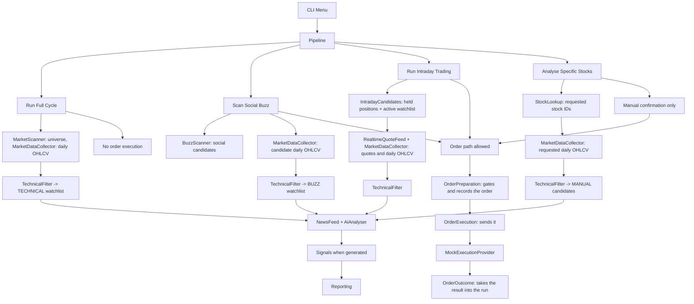

# TW Stock Alpha Agent

Application for Taiwan stock screening, report generation, watchlist management, and mock trade execution.

The current primary interface is the CLI. It scans Taiwan stocks, finds social buzz, runs technical and AI analysis, builds watchlists, and can submit orders through the currently wired mock execution provider.

This project is not financial advice. Treat generated signals as decision support.

## Current Status

- Market: Taiwan stocks.
- Primary UI: CLI at `backend/src/d_presentation/cli/interactive.py`.
- API: FastAPI at `backend/main.py` starts Full Cycle and specific-stock analysis (never order), and Buzz and Intraday on the mock broker only; reads runs, signals, orders, the watchlist and the account; serves market data and valuation; reads and saves the owner's technical strategies; and lets an administrator edit the allowlisted settings files. See [Web API](#web-api).
- Web UI: `frontend/` (Bun, React, Vite) on the same API through a same-origin `/v1` proxy. See [`docs/web-integration.md`](docs/web-integration.md).
- Order execution: `MockExecutionProvider` by default. `ShioajiExecutionProvider` (Sinopac) is wired for `execution_provider: shioaji`, see [Real broker (Shioaji)](#real-broker-shioaji). It has not been run against a real Shioaji account.
- Database: local SQLite at `stock_agent.db` with `db.backend: sqlite`. `db.backend: postgresql` uses the PostgreSQL credentials in `.env` and refuses to start without them.
- Knowledge store: ChromaDB path is configured by `config/appsetting.yaml`.

## CLI Workflows

Run the CLI from the repository root:

```powershell
just cli
```

Or run it directly:

```powershell
cd backend
uv sync --all-extras
$env:PYTHONPATH = "src"
uv run python -m d_presentation.cli.interactive
```

Menu behavior:

| Option | Workflow | What it does | Orders |
| --- | --- | --- | --- |
| 1 | Run Full Cycle | Scans the full market, builds a `TECHNICAL` watchlist, runs news and AI analysis, generates next-session signals. | Never submits orders. |
| 2 | Scan Social Buzz | Finds discussed stocks, enriches market data, keeps technical survivors as `BUZZ`, analyses them, generates signals. | Submits only if market and order checks allow. |
| 3 | Run Intraday Trading | Loads held positions and active watchlist, refreshes market data, revalidates technicals and AI, generates signals. | Submits only if market and order checks allow. |
| 4 | Analyse Specific Stocks | Loads the requested stock IDs and runs the technical filter, news and AI on every one of them, a technical failure included, then offers them all for the `MANUAL` watchlist. | No automatic order. Manual BUY override requires confirmation. |
| 5 | Value Specific Stocks | Shows TTM EPS from MOPS filings, the exchange's official close and the current P/E, asks a target P/E, then prints three fair-price scenarios and an AI explanation built from those numbers. | Never. No watchlist write either. |
| 6 | Scan Undervalued Stocks | Screens every listed and OTC stock at a target P/E and minimum undervaluation, optionally confirms the matches with the active technical strategy, and can ask the AI to explain the top matches. | Never. No watchlist write either. |
| 7 | Account History | Shows cash, positions with unrealized PnL at the latest quote, the equity curve since the first fill, and the account as of a date you enter. Warns about each position with no live quote, which is then priced at its last daily close, or at its average cost when no price came back. | Never submits orders. |
| 8 | Load Built-in Strategy | Lists the built-in technical strategies and Cancel. The chosen one replaces the saved strategy for menus 1, 2, 3, 4 and 6 until the CLI exits; the menu header names it. Saved settings and the Web API are unchanged. | Never. |

Every BUY or SELL decision ends as one row in the `orders` table with its run id and decision id: REJECTED with the reason when a gate refuses it (order mode, market closed, a quote older than `freshness.realtime_max_lag_minutes`). IOC orders trade only in continuous trading, 09:00 to 13:25 on weekdays; the opening call auction (08:30-09:00) and the closing call auction (13:25-13:30) take ROD only, so an order then is REJECTED as `MARKET_CLOSED`, otherwise what the broker did with it, including the fee, the tax and, for a SELL, the realized PnL. Orders are LIMIT at the decision's price and IOC. The limit is a valid exchange tick (`LimitPriceRule`, with the TWSE/TPEx tick table in `market.stock_ticks` and `market.etf_ticks`): a quote off the tick grid rounds up for a BUY and down for a SELL, and sizing prices a BUY at that limit. One run decides best composite score first, a tie going to the lower stock id. Each BUY risks `analysis.risk_per_trade_pct` of the account's equity: its cash plus every held position at the latest price the run has for it (the realtime quote, else the last daily close, else the average cost, as menu 7 marks it), fixed once before the run's first decision. The quantity is capped by the cash the run's earlier BUYs left, their fees included, so a run never commits more than the account's cash; when it runs out, the lower-scored stocks get HOLD. A manual BUY is sized the same way. Fees and tax come from `market` in `config/appsetting.yaml`: a SELL pays the transaction tax `tax_rate` (0.3%) on a stock and `etf_tax_rate` (0.1%) on an ETF, which is a code starting with `00`. A bond ETF, a `00` code ending in `B` such as `00679B`, pays no tax on a SELL traded on or before `bond_etf_tax_exempt_until` (2026-12-31), and `etf_tax_rate` after it.

### Specific Stock Flow

When you enter a stock such as `2330`, the app should only research that stock:

1. Load the stock from the stock provider.
2. Fetch OHLCV data and calculate indicators.
3. Run the technical filter.
4. Run news and AI analysis on the stock even when the technical filter failed it, so you see the whole report.
5. Show the stock report.
6. Offer the stock for the `MANUAL` watchlist.

Adding the stock to the watchlist is a separate manual confirmation. A manual BUY override is also separate. It is sized with fees included and still goes through the same order steps, which check the order mode, market-open status and the age of the quote. The CLI prints the order's status and reason, or why no order could be built.

## What Counts As "Good"

The project currently treats a stock as worth acting on only after multiple gates:

1. Technical filter has no hard failure.
2. News and AI analysis produce an acceptable report.
3. Combined score passes configured thresholds.
4. Account risk checks do not block the stock.
5. Order execution is allowed by the market clock.
6. Quantity and mock account constraints are valid.

Main thresholds live in `config/appsetting.yaml`:

```yaml
analysis:
  technical_weight: 0.5
  ai_weight: 0.5
  min_combined_score_buy: 80
  max_combined_score_sell: 30
```

### Technical strategies

A technical strategy is a list of rules, each a formula the user builds from parts, plus the score each rule's result adds or takes away. A name is only a label: the formula alone decides.

- Data: a field of a completed daily bar (`open`, `high`, `low`, `close`, `volume` in shares), `bars_ago` trading days back, or the latest price (the realtime quote, else the last close).
- Indicators: SMA of closes or volumes, RSI, MACD, Bollinger, Stochastic, ADX, ATR, OBV and MFI. Each has a stable id such as `ind_a` and parameters the user sets, such as `{"kind": "sma", "period": 37}`. Changing a period changes every rule that reads that id.
- Arithmetic (`add`, `subtract`, `multiply`, `divide`), comparisons (`gt`, `gte`, `lt`, `lte`, `eq`, `ne`, `crosses_above`, `crosses_below`) and `all`/`any` groups, nested as deep as needed.
- Effects: `block_on_fail` rejects the stock, `reduce_score_on_fail` and `increase_score_on_pass` move its score. Each rule's effect applies once.

A stock with fewer daily bars than its strategy needs, or whose formulas divide by zero or read a value its history cannot give, fails the technical step with score 0. No rule result stands in for missing data.

The developer ships three strategies, `config/strategies/conservative.json`, `balanced.json` and `aggressive.json`, listed under `technical.built_in_strategies` in `config/appsetting.yaml`. They score every stock as the criteria classes they replaced did (`backend/tests/test_built_in_strategies_regression.py`). An owner's first read of the settings saves an independent copy of all three, with `technical.initial_strategy_id` (`balanced`) selected for every workflow. Later saves go to the database through `PUT /v1/technical-settings` and never change the files. Menu 8 of the CLI loads a built-in strategy for the runs of that CLI session only.

## Watchlist Types

`WatchlistType` is the source of truth for why a stock is on the watchlist:

| Type | Meaning |
| --- | --- |
| `TECHNICAL` | Passed the full-market technical scan. Stays active through the close of the `watchlist.automatic_expiry_sessions`-th (1) trading session that opens after Full Cycle last selected it, so Friday evening's entries last through Monday's session. |
| `BUZZ` | Came from social buzz and passed technical filtering. Expires like `TECHNICAL`, counted from the last Buzz scan that selected it. |
| `MANUAL` | User reviewed a specific-stock report and manually added it. Never expires. |

A stock has one `watchlists` row per type, so it can be `TECHNICAL`, `BUZZ` and `MANUAL` at once. `WatchlistRule` renews an automatic row each time its workflow selects the stock again and never changes a `MANUAL` row. Adding a stock that is already on the manual watchlist prints `Already present on manual watchlist`.

## Application Flow



Important distinction:

- `NewsFeed` and `AiAnalyser` only gather news, ask the AI and combine the technical and AI scores into the composite score.
- `Pipeline` (`backend/src/b_application/pipeline.py`) holds every workflow as one method. Each method lists the use cases it runs, so it alone decides whether signals, reporting, watchlist writes or order steps happen.
- The order steps run one decision at a time: `OrderPreparation` checks the order mode, the trading phase and the quote's age and records the order, `OrderExecution` sends it to the broker, and `OrderOutcome` records what the broker did.
- `MarketScanner` loads the universe, `StockLookup` the requested stock IDs and `IntradayCandidates` the held and watched stocks. `MarketDataCollector` loads daily OHLCV, `RealtimeQuoteFeed` loads the realtime quotes that price orders, and `TechnicalFilter` calculates the strategy's indicators and applies its rules.

## Architecture

The code follows the existing Clean Architecture split:

| Layer | Path | Responsibility |
| --- | --- | --- |
| Domain | `backend/src/a_domain` | Models, ports, enums, pure rules. No application, infrastructure, or presentation imports. |
| Application | `backend/src/b_application` | Use cases, the one `Pipeline` with every workflow, the pipeline status, and the settings classes in `b_application/config/`. |
| Infrastructure | `backend/src/c_infrastructure` | Database, market data, AI adapters, feed providers, LINE platform, mock trading. |
| Presentation | `backend/src/d_presentation` | CLI, Web API, the one composition root both use (`dependencies.py`). |

Application use cases coordinate work. Domain rules own business decisions. Infrastructure implements ports.

## Configuration

Main files:

| File | Purpose |
| --- | --- |
| `config/appsetting.yaml` | Active AI model (`ai.active_model`, Claude Haiku by default), logging, analysis weights, thresholds, folders, mock account, the technical settings owner and built-in strategy list, and under `sources` every outside endpoint (TWSE, TPEX, MOPS, PTT, news, AI, LINE) with the text formats their pages use, their timeouts and how much of each page is read. The settings classes are in `backend/src/b_application/config/`. |
| `config/strategies/*.json` | The built-in technical strategies, one file each. An owner's own strategies and selections are saved in the database. |
| `config/instructions.yaml` | AI report prompts and RAG injection prompts. |
| `.env` | API keys, optional database credentials and the Shioaji credentials. |

### Real broker (Shioaji)

The shipped settings use the mock broker in `mock_only` order mode. The CLI and the Web API refuse to start a combination that could send an order nobody meant to send, and says what to change:

| `environment` | `execution_provider` | `order_mode` | Starts? |
| --- | --- | --- | --- |
| any | `mock` | `mock_only` or `disabled` | Yes. |
| any | `mock` | `live` | No. Live order mode needs Shioaji. |
| `dev` | `shioaji` | any | No. DEV never touches a real broker. |
| `test` or `live` | `shioaji` | `mock_only` | No. Use `disabled` to read the Shioaji account without ordering. |
| `test` or `live` | `shioaji` | `disabled` | Yes. Cash and positions come from Shioaji, no order is sent. |
| `test` | `shioaji` | `live` | No. Live order mode needs `environment: live`. |
| `live` | `shioaji` | `live` | Yes. Menus 2 and 3 and a confirmed manual BUY send orders to Shioaji. |

`shioaji.simulation: true` (the default) logs in to Shioaji's paper-trading environment. Set it to `false` only after testing there; the account is then real money. Shioaji needs `SHIOAJI_API_KEY` and `SHIOAJI_SECRET_KEY` in the environment or `.env`, and in production also `SHIOAJI_CA_PATH`, `SHIOAJI_CA_PASSWORD` and `SHIOAJI_PERSON_ID`. With any non-mock broker the menu header shows a red REAL BROKER panel with the broker, simulation or production, and the order mode.

How the adapter trades: quantities are shares; whole 1000-share lots go as one board-lot order, LIMIT IOC, and the rest as one intraday odd-lot order, LIMIT ROD, because TWSE and TPEx take intraday odd lots as ROD only. Before sending, it refuses a BUY that the cash cannot pay, because the broker checks the trading limit, not the cash. Cash is the bank balance minus settlement payments due and minus the BUYs the broker lists as dealt today. A part still working after `shioaji.max_polls` status reads `shioaji.poll_interval_seconds` apart (about five seconds) is cancelled, the odd-lot ROD part included, so no order is left working. The order then ends with what filled and its fee, and its reason lists each part with its time in force, its status and the shares it dealt. A part the broker still reports as working after the cancel, or a timed-out call it cannot find again, ends the order FAILED with a reason that says to check the broker.

Environment variables are loaded from `.env` or `../.env` relative to the backend process. Common keys:

```env
OPENAI_API_KEY=
GROK_API_KEY=
GEMINI_API_KEY=
GROQ_API_KEY=
NVIDIA_API_KEY=
ANTHROPIC_API_KEY=
TAVILY_API_KEY=
LINE_CHANNEL_ID=
LINE_CHANNEL_SECRET=
LINE_CHANNEL_ACCESS_TOKEN=
API_TOKEN=
ADMIN_API_TOKEN=
DB_USER=
DB_PASSWORD=
DB_HOST=
DB_PORT=
DB_NAME=
```

`db.backend` in `config/appsetting.yaml` chooses the database, never the `DB_*` keys. `postgresql` needs `DB_USER`, `DB_PASSWORD`, `DB_HOST` and `DB_NAME`. `sqlite` keeps the local `stock_agent.db`, and refuses to start while all four are set.

## Development Commands

From `backend`:

```powershell
uv sync --all-extras
$env:PYTHONPATH = "src"
uv run ruff check .
uv run ruff format --check .
uv run pytest -q
uv run python tools/architecture_check.py src --pyright
```

`tools/architecture_check.py` checks the rules of `docs/clean_architecture_guide.md` (layer direction, one `apply` per domain rule, one `execute` per use case, `@override` on every adapter method, function length and complexity, no hard-coded URLs) and, with `--pyright`, counts pyright errors. It prints a count per rule and must end at `TOTAL 0`.

Run the API and the web UI, in this order, from the repository root:

```bash
just run-bn   # backend Web API on http://127.0.0.1:8800, one worker; API_TOKEN and ADMIN_API_TOKEN from .env
just run-fn   # frontend dev server on http://127.0.0.1:5173, proxying /v1 to the backend
```

`API_TOKEN` opens the owner's data and `ADMIN_API_TOKEN`, a different value, opens only the settings files; both are
long random strings you put in `.env` yourself. The browser keeps them in the tab's memory only. `HOST` and `PORT`
move the backend; serve another network only behind a TLS reverse proxy (see `docs/web-integration.md`).

Run Docker:

```powershell
docker compose up --build
```

## Web API

The API runs on the same runtime as the CLI: `backend/src/d_presentation/dependencies.py` builds it once at startup, with the same trading-setup checks, so the API refuses to start on any setup the CLI refuses. The OpenAPI page is at `/docs`; `frontend/src/shared/api/openapi.json` is the committed contract the web UI generates its types from.

Scopes: public (built-in strategies, `/v1/market`), owner (`Authorization: Bearer <API_TOKEN>`: every write and every private read) and administrator (`Bearer <ADMIN_API_TOKEN>`: `/v1/admin` only). A scope whose token is unset answers 403; the administrator scope also while its token equals `API_TOKEN`. Every write repeats `"confirm": true`. Requests must name a host in `api.allowed_hosts` (127.0.0.1 and localhost by default).

| Method and path | Scope | What it does |
| --- | --- | --- |
| `POST /v1/runs/full-cycle`, `/v1/runs/specific-stocks` | owner | Start menu 1 or menu 4's analysis (at most 20 stock ids) in the background: 202 with the run id. They never order. |
| `POST /v1/runs/buzz-scan`, `/v1/runs/intraday` | owner | Start menus 2 and 3 only while the execution provider is the mock broker (403 otherwise). Their orders go through the same gates and journal as the CLI's. |
| `GET /v1/runs?limit&offset`, `/v1/runs/{id}`, `.../signals`, `.../orders` | owner | Runs newest first, a run's state, record and saved stock reports, its decisions and orders. |
| `GET /v1/watchlist`, `POST /v1/watchlist/manual`, `POST /v1/watchlist/manual/remove` | owner | Active entries with names; add or remove MANUAL entries only. |
| `GET`/`PUT /v1/technical-settings` | owner | The owner's strategies with the `revision` a save must carry (409 when stale, 422 when invalid). |
| `GET /v1/technical-settings/built-in-strategies` | public | The built-in strategies. |
| `GET /v1/market/stocks?query`, `/v1/market/most-traded`, `/v1/market/stocks/{id}` | public | Listing search, the latest session's most traded stocks, a stock's cached daily bars. No realtime quote. |
| `GET /v1/market/stocks/{id}/technical` | owner | The active strategy's evaluation of the stock and each indicator at every bar it read. |
| `GET /v1/valuation/market`, `/stocks`, `/scan`; `POST /v1/valuation/explanation` | owner | Menus 5 and 6, read-only. Only the explanation calls the AI, once per confirmed request. |
| `GET /v1/account/history?as_of=` | owner | Menu 7, with the execution provider and order mode it reads. |
| `/v1/admin/settings...`, `/v1/admin/audit` | administrator | The allowlisted settings of `appsetting.yaml` and `instructions.yaml`: read, preview, save with revision, backups, restore, audit. A save applies at the next start. |

One workflow runs at a time per server process; a second start answers 409. Run the API with one worker.

## Data Written Locally

- `stock_agent.db`: SQLite application and mock trading state. The trading record is `workflow_runs`, `trade_signals`, `orders` and `account_snapshots`; the mock broker's book is `mock_cash` and `mock_positions`. Each owner's technical settings are `technical_settings` (selections and revision), `technical_strategies`, `technical_indicators`, `technical_rules` and `technical_formula_nodes` (one row per part of a rule's formula), tied together by foreign keys.

Tables are created with `create_all`, which never changes an existing table. A new database also gets a `schema_version` row, the code's `SCHEMA_VERSION` (`backend/src/c_infrastructure/database/models/schema_version_dto.py`), which says how its rows are stored. A database of an older version is upgraded in place at startup, one step of `UPGRADES` in that file per version, in one transaction, and keeps its rows: version 1 to 2 adds `workflow_runs.failure`, filled in for the runs that stopped by an exception. At startup the app stops, changing nothing, when the database is not new and its schema version is missing or one no upgrade reaches, or when an existing table's columns differ from the code. The message names each table to drop. A `stock_agent.db` made before the schema version existed is refused for every table, because several of its tables hold Taiwan wall-clock times that the current code reads as UTC. Delete that file, or drop the tables the message names; the next start recreates them empty. Cached prices and EPS refill themselves, while the mock account, watchlist and trading rows in a dropped table are lost. Such a file's `mock_positions` also hold average costs without the buy fee, and its unused `mock_orders` table can be dropped.
- `chroma_data/`: Chroma persistence.
- `news_archive/`: archived news payloads.
- `buzz_archive/`: archived social buzz payloads.
- `ai_responses/`: saved AI outputs.

## Safety Rules

- Every BUY or SELL decision gets one `orders` row before anything reaches the broker. A closed market, a disabled order mode or a quote older than `freshness.realtime_max_lag_minutes` makes that row `REJECTED` with the reason, and nothing is sent.
- `Run Full Cycle` does not call order execution.
- The Web API starts Buzz and Intraday only while the execution provider is the mock broker, through the same order gates and journal as the CLI; every other endpoint never orders, and the Web has no manual BUY. Every write needs `API_TOKEN` and `confirm: true`; the settings editor needs `ADMIN_API_TOKEN` and never changes the environment, broker, order mode, the score weights and thresholds, sizing, stop-loss, or the history and quote freshness.
- Manual BUY override is explicit user intent and still uses the same order checks.
- Real orders need `environment: live`, `execution_provider: shioaji`, `order_mode: live` and the Shioaji credentials together. Any other combination with Shioaji either refuses to start or only reads the account.

## Known Cleanup Areas

- Keep README, CLI text, workflow behavior, and tests aligned whenever a workflow changes.
