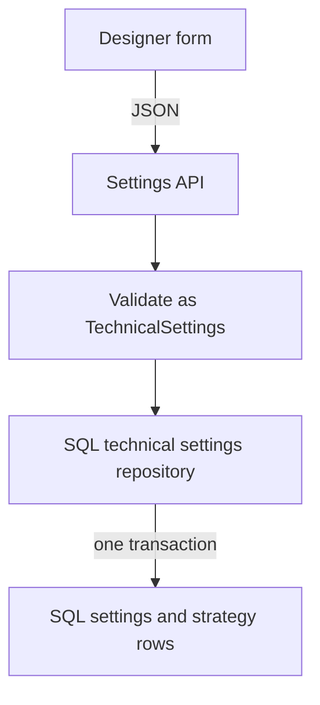

# Strategy designer

> Implemented design: [Technical strategy formulas](technical-strategy-formulas.md). Where this document disagrees with it, this document is history.

> Latest implementation handoff: [中文交接文件](strategy-implementation-handoff-2026-11-03.zh-TW.md).
> It includes the later custom-formula discussion, configurable indicator identities,
> SQL normalization preference, review comments and the current failing baseline.
> Conflicting storage and formula proposals below are historical; they are not a final contract.

Date: 2026-11-03.
Status: interaction direction agreed; backend details below are an implementation proposal.
The conversation prototypes are not a frontend implementation. This document does not claim
that the current checkout passes its tests or implements these features.

This records the latest designer direction. It replaces the template-only editor proposal
and conflicting CLI editing proposals in earlier notes, including `03112026.md`.
[The architecture guide](clean_architecture_guide.md) remains the code rulebook.

## Product direction

Keep one editor with freely configurable conditions. Built-in combinations help users get
started; they must not limit what users can build. Users do not edit JSON or enter internal
references such as `ma20.value`.

There are three different things:

| Thing | Purpose |
| --- | --- |
| Built-in strategies | Developer-maintained Conservative, Balanced and Aggressive presets. |
| Quick-fill combinations | Fill an editable condition, such as a moving-average crossover or increased volume. |
| Custom strategies | Independent user definitions, created from a preset or from scratch. |

Quick fill populates the same editor used for custom conditions. After using it, users can
change the data, output, parameters, comparison, reference, date and multiplier. It does not
switch to a restricted editor. Users can also start directly with the data selectors.

Saving a preset as a custom strategy creates a new strategy ID and a complete independent
definition. Later edits to a preset do not change saved copies. A new strategy does not
require a new physical JSON file for each service user.

## Editor outline

```text
Quick fill: volume vs average | volume vs previous day | MA crossover | MACD crossover | RSI

Observe this data        Comparison             Compare against this reference
[data / indicator]      [above / below / ...]   [number / data / indicator]
[its parameters]                               [its parameters]
[output, when needed]                          [output, when needed]
[sample date]                                  [sample date and multiplier]

Readable condition preview
[Add condition]

Conditions: [all must match / any may match]
1. ... [edit / remove]
2. ... [edit / remove]
```

- Group the available data into price, volume and technical indicators.
- Show parameters appropriate to the selected indicator. Do not force every indicator into
  one `period` field: MACD needs fast, slow and signal periods and an output selector.
- Offer a sensible reference when selecting data, while keeping the reference editable.
- For MACD, offer another output of the same configured instance. Changing its periods must
  update both outputs; comparing a separately configured MACD remains possible.
- Keep comparison choices explicit: above, at least, below, at most, crosses above and
  crosses below. A value already above another value is not a new crossing.
- Generate the readable preview from the selected condition. Do not maintain a separate
  sentence that can disagree with the saved definition.
- Explain invalid combinations beside the fields. A UI warning does not replace backend
  validation.

## Volume and dates

The initial editor uses completed daily bars. Dates refer to trading sessions, not calendar
days. The sample date and the indicator calculation period are separate settings.

| Data | Configuration |
| --- | --- |
| Volume | Which completed trading session supplies the volume. |
| Average volume | Window length and the session on which the window ends. |
| Relative volume | Volume divided by its stated average-volume baseline. |
| A volume condition | Compare with a number, another volume or an average, optionally multiplied. |

Support examples such as latest volume above previous-session volume times a multiplier,
latest volume above the preceding N-session average, and a short average above a long average.
The same editor must also support fixed volume thresholds and relative-volume thresholds.

Always state whether an average includes the latest session. The volume quick fill uses the
preceding N completed sessions, excluding the latest session. Window lengths and multipliers
are configurable examples, not claims about optimal trading settings.

Use shares as the canonical volume unit, matching the existing data. Label numeric volume
thresholds accordingly. If the UI later displays lots, convert at the boundary without
changing the meaning of the saved threshold. A zero or unavailable average cannot produce
a valid relative-volume result.

## One executable strategy definition

The UI draft becomes one validated strategy definition. Built-in and custom conditions use
the same representation and execution path. A quick-fill name never selects a Python class.

| Part | Meaning |
| --- | --- |
| Indicator instance | Stable ID, supported indicator kind and validated parameters. Multiple RSI or SMA instances may coexist. |
| Series reference | Market field or indicator output, sample offset and optional multiplier. |
| Constant | A finite numeric threshold. |
| Comparison | Left input, supported operator and right input. |
| Condition group | All or any of its child conditions. |
| Strategy | Its identity, indicator instances, conditions and existing scoring/effect settings. |

Prefer the existing named indicator instances over repeating their parameters inside each
operand. Two outputs of the same MACD should reference one instance. Comparing two different
MACDs uses two instances. The UI manages these IDs; users see readable labels.

Copying a quick-fill definition expands it into editable inputs and conditions. Saving
retains the complete definition, not only a template ID or a live link to the template.
An optional template ID may help the UI, but cannot be the executable source of truth.

## Python implementation direction

Use the existing concept files before adding files or wrappers:

| Existing location under `backend/src/` | Responsibility |
| --- | --- |
| `a_domain/rules/technical/calculation/formulas.py` | Keep the numerical indicator formulas. |
| `a_domain/rules/technical/calculation/calculator.py` | Validate indicator parameters and calculate the referenced output samples. Extend volume calculations here when needed. |
| `a_domain/model/indicators/technical_indicators.py` | Hold calculated samples without choosing strategy outcomes. |
| `a_domain/rules/technical/condition.py` | Define inputs and conditions; resolve offsets and multipliers; evaluate comparisons, crossings and groups. Keep these related parts together. |
| `a_domain/rules/technical/strategy.py` | Keep strategy composition, `TechnicalRule`, `TechnicalScoring` and effects together. Names are labels. |
| `b_application/use_cases/process/technical_filter.py` | Orchestrate calculation and evaluation, and return the report/candidates. |
| `c_infrastructure/technical/` | Read/write preset and saved documents through the existing repository boundary. |
| `d_presentation/web/routers/technical_settings.py` | Accept input, call the application operation and return a response. |

Use pydantic dataclasses for domain definitions. Prefer `TypeAdapter` to validate and
serialize those definitions directly, rather than maintaining equivalent domain, file and
HTTP schema classes. An outer API request may still carry confirmation/revision metadata.

For the all-JSON direction, validation is a data-boundary operation, not a separate validator
service or compiler. The repository restores the same domain models from files or SQL;
the existing `StrategyLoader` selects the strategy for this run. Loading precedes history
collection because the selected strategy determines the required history length.

For example, after agreeing on the strategy document shape:

```python
from pydantic import TypeAdapter

from a_domain.rules.technical.strategy import TechnicalStrategy

adapter = TypeAdapter(TechnicalStrategy)
strategy = adapter.validate_python(document)
saved_document = adapter.dump_python(strategy, mode="json")
```

This is the serialization direction, not a replacement implementation. The document must
match the domain shape; changing keys or expanding defaults still needs an explicit decision.

Expose indicator choices, parameter constraints, supported outputs and comparisons to the
future editor from the same definitions the backend uses. UI labels can be localized in
presentation. Do not create a second validation/calculation catalog in the frontend.

Two details need explicit implementation:

1. **Historical samples.** A reference needs a sample offset (`bars_ago` is a proposed name).
   A crossing checks offsets k and k+1. Comparing against a prior-session average can require
   a sample two sessions back when evaluating the preceding side of a crossing. The current
   `current`/`previous` snapshots alone are insufficient. Prefer one offset-indexed sample
   collection to adding `previous_previous` fields. Derive required history from indicator
   warm-up plus the largest referenced offset and any extra crossing sample.
2. **Groups and effects.** Preserve the editor's all/any choice. The current flat scoring loop
   does not implement an OR filter merely by receiving several rows. Use a grouped
   `TechnicalCondition` inside a `TechnicalRule`; its effect applies once to that group.
   Preserve other blocking, penalty and bonus rules when editing a group. Do not flatten an
   existing preset into one filter and discard its scoring behavior.

Do not add a Python criterion class for each quick-fill name, evaluate text as Python,
introduce legacy compatibility, or add pass-through layers solely to satisfy the checker.
Resolve architecture conflicts under section 0 of the guide before implementing them.

## Concrete engine proposal

Keep the engine in the existing calculation, condition and strategy concept files. It is
their collaboration, not an additional `Engine` wrapper.

### Condition shapes

Refine `condition.py` into three related dataclass shapes in the same file:

| Shape | Fields |
| --- | --- |
| Series reference | `series`, nonnegative `bars_ago`, finite `multiplier`. |
| Comparison | A comparison operator, `left`, `right`. Each input is a numeric constant or a series reference. |
| Group | `operator` is all/any; `conditions` is a nonempty sequence of comparisons or groups. |

`TechnicalCondition` can be a discriminated union of Comparison and Group. Pydantic can
then reject a comparison with missing inputs or a group with comparison-only fields, rather
than using one class with several mutually exclusive nullable fields. Keep the supported
operator values in the existing enum file. The shape names are proposals, not new files.

The indicator calculator produces the required samples per stock. For each series, sample
index 0 is the latest completed session, index 1 is the previous session, and so on. Reusing
one configured indicator in several conditions reuses its calculated samples.

Resolving an input at evaluation step k means:

```text
constant: use the constant
reference: samples[reference.series][reference.bars_ago + k] * reference.multiplier
```

An ordinary comparison uses k=0. A crosses-above comparison requires both:

```text
left(k=1) <= right(k=1)
left(k=0) >  right(k=0)
```

Crosses below reverses the inequalities. All/any combine child results. The strategy applies
the existing `TechnicalRule.effect` once to the result of each named rule/group and builds
`TechnicalReport`. A successful blocking condition does not automatically earn bonus points.

Before evaluating a stock, check that the referenced samples are available and finite. The
initial proposed policy is to report unavailable technical data and stop that stock's
technical evaluation when required inputs are missing, rather than filling them with zero.
The rule label must not be reported as an ordinary failed comparison when no input existed.

### Example definition body

The SQL row carries strategy identity and name. Its `definition_json` can contain this body:

```json
{
  "indicators": {
    "fast": {"kind": "sma", "period": 20},
    "slow": {"kind": "sma", "period": 60},
    "volume20": {"kind": "volume_sma", "period": 20}
  },
  "scoring": {
    "base_score": 50,
    "block_failure_penalty": 15,
    "failure_score_reduction": 5,
    "pass_score_increase": 5
  },
  "rules": [{
    "name": "Upward crossover with increased volume",
    "effect": "block_on_fail",
    "condition": {
      "operator": "all",
      "conditions": [
        {
          "operator": "crosses_above",
          "left": {"series": "fast.value"},
          "right": {"series": "slow.value"}
        },
        {
          "operator": "gt",
          "left": {"series": "daily.volume"},
          "right": {"series": "volume20.value", "bars_ago": 1, "multiplier": 1.5}
        }
      ]
    }
  }]
}
```

The UI generates this data. It need not expose these identifiers to users. The example's
numeric settings illustrate configuration, not preferred trading parameters.
When converting existing presets, review their comparison semantics explicitly. Replacing
an already-above alignment check with a newly-crossed event changes behavior.

This example needs 61 completed bars: the 60-session average needs its current and preceding
samples for the crossover. Its preceding 20-session volume average needs 21 bars. Compute
the largest requirement across the references. A crossover that itself references a
prior-session average would require another preceding sample.

Keep units and valid outputs in the supported indicator definitions. Validate output
references, parameter bounds and compatible comparison units before saving. A relative
volume output is a supported numerical calculation with an explicit baseline; it is not a
free-form expression submitted by the client. Adding a new formula still requires Python.

## Storage, API and CLI

- Recommend JSON for developer presets and quick-fill definitions as well as API documents.
  This follows the latest preference to use one strategy serialization format. Other app
  configuration, such as `appsetting.yaml`, is a separate concern.
  The three built-in strategies can have separate files;
  do not require shared inheritance to understand one strategy.
- Users do not author JSON in the normal editor flow. JSON describes supported calculations
  and conditions; it is not executable Python.
- Save independent user settings through SQL: local SQLite and a separate PostgreSQL service
  deployment. Use JSON-compatible dictionaries for definition columns and let SQLAlchemy
  serialize them. Do not encode a JSON string inside a JSON column.
- Refine the earlier one-JSON-document-per-owner proposal into the hybrid below. This keeps
  relational ownership and selection fields while retaining each complete rule definition
  as one document. It is not full normalization of the nested conditions.

| Proposed table | Columns |
| --- | --- |
| `technical_settings` | `owner_id` primary key, `active_strategy_id`, `buzz_strategy_id`, `revision`. |
| `technical_strategies` | Composite primary key (`owner_id`, `strategy_id`), `name`, `definition_json` containing indicators, scoring and rules. |

Selections reference (`owner_id`, `strategy_id`) so an owner cannot select another owner's
strategy. Keep identity/name in columns rather than duplicating them inside the JSON body.
On load, the repository combines those columns with the body to validate a complete
`TechnicalStrategy`, then assembles the owner's `TechnicalSettings`.

Keep the existing whole-settings save contract and one revision per owner initially.
Validate the complete document and save selection changes plus strategy rows atomically,
checking that revision in the same transaction. This avoids adding several independent CRUD
operations before they are needed. A new table layout does not require changing the engine
or adding another application layer.

Full normalization would also separate indicator instances, condition nodes, parent/child
ordering and operands. That is possible behind the same repository, but is not recommended
for the initial whole-strategy read/write workflow. Reconsider it when individual-node SQL
queries or independent node updates become real requirements. Mutable indicator settings
remain owned by each strategy; sharing a formula does not imply sharing users' settings.

This replaces the earlier YAML storage and whole-owner-JSON proposals. No database migration
has been applied by this design work.

- Initialize new users once with an independent default document and Balanced selected.
  Subsequent loads preserve their saved definitions and selection.
- Preserve owner scoping and revision conflicts. Service identity must come from an
  authenticated account; a configured local profile ID is not account authentication.
- Chroma keeps its existing memory role.
- Keep the CLI limited to loading Conservative, Balanced and Aggressive. Editing/saving is
  exposed through the backend API for future website/iOS clients.
- Saving changes subsequent runs. A running analysis retains its loaded strategy snapshot.

## Data flow in this project

### Saving from the future designer



The intended request entry is the existing `PUT /v1/technical-settings` route. It validates
the document through the agreed domain definitions and calls the application operation.
The application passes the owner-scoped settings to `ITechnicalSettingsRepository.save`.
The SQL adapter maps the document into settings and strategy rows only when the caller's
revision matches, then returns the new revision. Owner and revision are separate SQL metadata,
not duplicated inside each strategy. The backend supplies owner identity.

### Creating defaults or copying a built-in strategy

Preset JSON -> `json.load` -> the same domain validation -> independent definition.

For a new owner, initialize the settings document once and select Balanced. For a user
copy, give the copied strategy its own ID and save its full definition through the normal
save path. Updating a preset file never rewrites existing user documents.

The CLI's session-only preset selection can load preset JSON directly through
`StrategyLoader.execute(..., preset_id=...)`. Selecting it does not require saving a SQL
copy. API analysis normally uses the owner's saved selection.

### Running an analysis

Use the existing `Pipeline.run_full_cycle` operation as the concrete example:

```text
Pipeline.run_full_cycle
  -> StrategyLoader.execute
       -> repository.load(owner_id)
       -> SQL settings/strategy rows -> validated TechnicalSettings
       -> selected TechnicalStrategy snapshot
  -> MarketDataCollector.execute(required_bars=strategy.required_bars)
       -> Stock.ohlcv
  -> TechnicalFilter.execute(stocks, strategy, stats)
       -> TechnicalIndicatorCalculator.apply(stock.ohlcv)
       -> Stock.indicators
       -> TechnicalStrategy.apply(stock)
            -> TechnicalCondition.apply(calculated samples)
       -> Stock.technical_report
       -> surviving stocks returned to PipelineStatus
```

The calculator and evaluator receive Python objects and numerical samples. They do not
parse HTTP JSON or query the settings tables for each stock.

For example, a volume condition stores a 20-session average configuration, a prior-session
sample reference, a multiplier of 1.5 and an above comparison. At execution, the calculator
produces the volume and average; the evaluator compares those numbers. The stored document
describes the calculation; it does not replace the indicator formulas.

### What is not connected yet

The current checkout is still partway through the earlier refactor:

- `d_presentation/dependencies.py` still imports/constructs the deleted
  `YamlTechnicalSettingsRepository`, and does not supply the newly required owner ID when
  constructing `StrategyLoader`. The shipped strategy source is still `technical.yaml`;
  converting it to the proposed JSON files has not been implemented.
- The settings router still calls the old repository signatures and reset operation. It
  needs the application boundary, owner scoping and revision contract wired consistently.
- `TechnicalSettingsDTO` and the SQL repository currently use `settings_yaml`. Implement
  the proposed hybrid tables and inspect existing settings rows before changing that table.
  Preserve other application data.
- The Pipeline's collection calls do not yet pass the strategy's required history length.
  The sample model/evaluator also need the historical-offset support described above.
- The SQL repository has a syntax error in its final exception handler, and the reviewed
  legacy branch is still present. Resolve both as part of completing that adapter.

A prior bounded experiment with the actual, still-YAML preset files completed Python ->
in-memory SQLite JSON -> Python with equal results. A later isolated experiment verified
typed comparison/group shapes, upward-crossing boundaries, a preceding-volume-average
reference, all/any groups, JSON round-trip, invalid offsets and a missing historical sample.
These do not establish that the application API, complete Pipeline, hybrid SQL layout or live
PostgreSQL path works. No application database was changed.

## Implementation order and checks

1. Complete one comparison through typed input, indicator calculation and evaluation. Add
   offset and multiplier behavior before changing every preset or caller.
2. Cover volume averages, relative volume, crossings and all/any groups with deterministic
   examples. Missing samples must not become zero or silently reward a rule.
3. Prove that the same strategy survives Python -> JSON -> Python with its IDs,
   parameters, offsets, groups and effects intact. Then reduce duplicate schema mappings.
4. Define the three strategy presets and editable quick fills. Test copying, renamed labels,
   independent saves and preservation of existing settings.
5. Finish repository/API/CLI wiring and update callers, fakes and tests together. Run the
   repository checks and the verification skills required by `AGENTS.md` for code changes.
6. Build the frontend only when requested, against the agreed backend definition and catalog.

The scoring controls, arbitrary nested-group UI and exact API payload remain implementation
design work. Preserve their existing semantics; this interaction decision does not authorize
silently removing them. The prototype's local state is not the final API contract.

## References

- [Chartink scanner guide](https://chartink.com/articles/scanner/scanner-user-guide/): data,
  indicators, historical offsets, arithmetic and combined filters.
- [StockCharts volume comparisons](https://help.stockcharts.com/scanning-and-alerts/scan-writing-resource-center/scanning-case-studies/scanning-for-consolidation-and-breakouts): comparisons with a preceding average and a multiplier.
- [TradingView relative volume](https://www.tradingview.com/support/solutions/43000635874-how-do-we-calculate-relative-volume-and-relative-volume-at-time/): an example of explicitly excluding the current bar from the average baseline.
- [SQLAlchemy JSON type](https://docs.sqlalchemy.org/en/20/core/type_basics.html#sqlalchemy.types.JSON): a JSON column interface supporting PostgreSQL and SQLite.
- [PostgreSQL JSON document design](https://www.postgresql.org/docs/current/datatype-json.html#JSON-DOC-DESIGN): relational and JSON structures can coexist; documents should have predictable structure and manageable boundaries.
